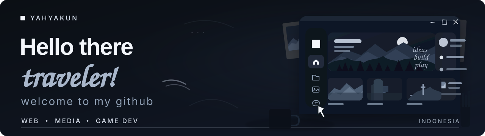

### About me

Hi, I'm **Nur Yahya Akhmad**. I'm currently studying IT at **Universitas Negeri Makassar**.

Most of the stuff here comes from things I wanted to try, fix, or build for myself. I like messing around with web projects, small tools, digital media, and sometimes game-related stuff.

A lot of what I know came from tutorials, trial and error, reading random documentation, and using AI when I get stuck.

I'm still learning, but I'd like to eventually get more serious about **game development**.

  

When I'm not working on something, I'm probably playing games, listening to music, or picking up my guitar for a while.
